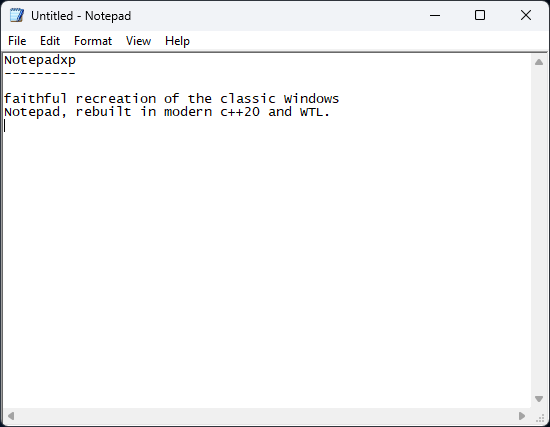

# NotepadXP

**A mostly faithful recreation of the classic Windows Notepad, rebuilt in modern C++20.**

NotepadXP is a single-binary Windows text editor that recreates the classic (pre-Windows 11) Notepad.
it aimes to provide the classic notepad look and feel while also containing more modern quality of life
features so you'd actually like using it.

Built as a snappy alternative to the modern Notepad, which has grown tabs, Copilot, and other bloat. NotepadXP brings back the instant, focused single-file editor on a clean C++20 / WTL codebase: `ANSI / UTF-8 / UTF-16` encoding detection, `Find & Replace`, `Go To`, `Word Wrap`, `font selection`, `printing with headers/footers`, and a `live Ln/Col status bar` — plus quality-of-life touches the original lacked, like `multi-level undo/redo` and `Ctrl+Backspace` word delete.

## Quick Start
```cmd
notepadxp.exe                 # start with an empty document
notepadxp.exe notes.txt       # open a file
notepadxp.exe /A notes.txt    # open, forcing ANSI encoding
notepadxp.exe /W notes.txt    # open, forcing Unicode (UTF-16)
```

## Large files

Documents under 16 MiB of text use the classic Win32 Edit control — bit-for-bit
classic Notepad behavior. Larger documents switch to **FastEdit**, a built-in
virtualizing editor control with the same message interface: it paints only the
visible lines and keeps a line index instead of rebuilding one, so opening,
editing, Go To, and font zoom stay in the milliseconds at 100 MB+ where the
stock control took 5–45 seconds per operation.

- **Async open with progress and Cancel** — files ≥ 16 MiB decode on a worker
  thread behind a progress dialog (ANSI / UTF-8 / UTF-16 detection included).
- **Streaming save** — text is converted and encoded in chunks straight off the
  editor buffer; no full copy of a large document is ever held, and the save
  lands via a temp file + move, so a failed or declined save never truncates
  the document.
- Word wrap is disabled in large-document mode (the classic control's rewrap
  was the single worst offender); the wrap menu item is grayed out there.
- The classic 1 GiB size limit still applies, matching original Notepad.

`bench/` measures all of this end-to-end (`python ../../vcbuild/vcbuild.py
release` then `./build/notepadxp_bench.exe [maxMB]`).

#### WTL GUI

